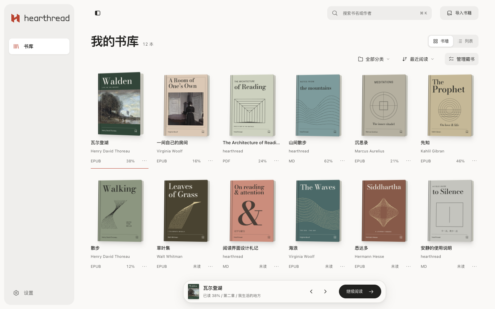
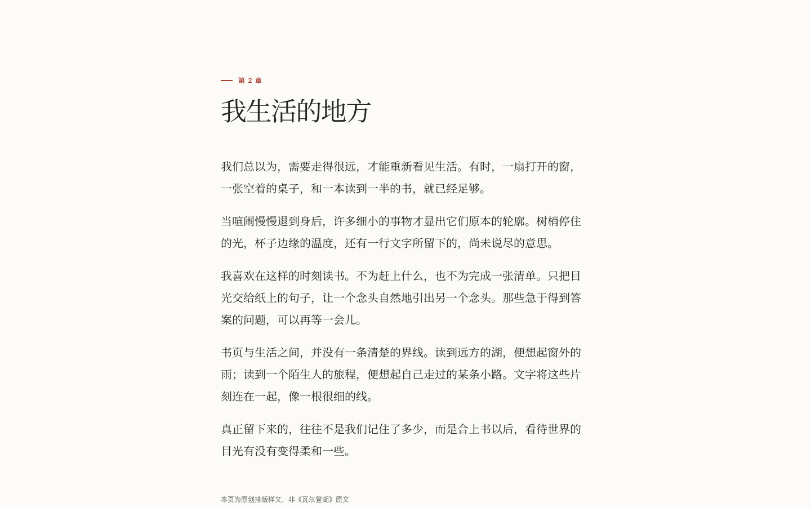

# hearthread

English · [简体中文](README.zh-CN.md)

hearthread is a local-first, cross-platform personal library. It starts with immersive reading. Today you can keep EPUB books, PDFs and Markdown documents on one shelf, read them offline and pick up where you left off. The longer-term goal is to organize books, documents and images together.





## What you can do

- Browse by cover or switch to a list. Drop files into the import dialog, find a title or author, and move several books into a category at once.
- Double-click a cover to read. Tap the page to bring up the controls. Change the font, line spacing and paper color, or search the text for a passage.
- Reflow an EPUB and jump between chapters, fit a PDF to the page or screen width, or read Markdown with tables and code blocks. Reopening a file restores your place.
- Export an original file or back up the whole library to a ZIP, including reading positions and preferences. Restore the ZIP on another device to take your library with you.

## Local development

Use Bun 1.3.10 and Node.js 22.23 or later. To run the native app, install stable Rust and the tools for your platform. On macOS, install Xcode Command Line Tools. On Windows, install the MSVC C++ build tools and WebView2. [Tauri platform prerequisites](https://v2.tauri.app/start/prerequisites/)

From the repository root, install dependencies and launch the desktop app.

```sh
bun install --frozen-lockfile
bun run tauri dev
```

For browser development, run `bun run dev` and open `http://127.0.0.1:1420`. The browser keeps its own library in IndexedDB. The native app stores files and a SQLite catalog in its application data directory. You can transfer a library between them with a ZIP backup.

| Build target | Command |
| --- | --- |
| macOS app | `bun run tauri build --bundles app` |
| Windows desktop | `bun run tauri build` |
| iOS simulator on Apple Silicon | `bun run tauri ios build --debug --target aarch64-sim` |
| Android arm64 debug APK | `bun run tauri android build --debug --apk --target aarch64` |

The current interface is in Simplified Chinese. The macOS build has been tested locally. The repository also includes projects for Windows, iOS and Android. [Platform verification notes (Chinese)](docs/verification/README.md)
