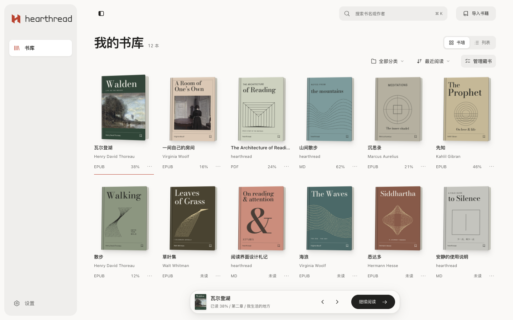
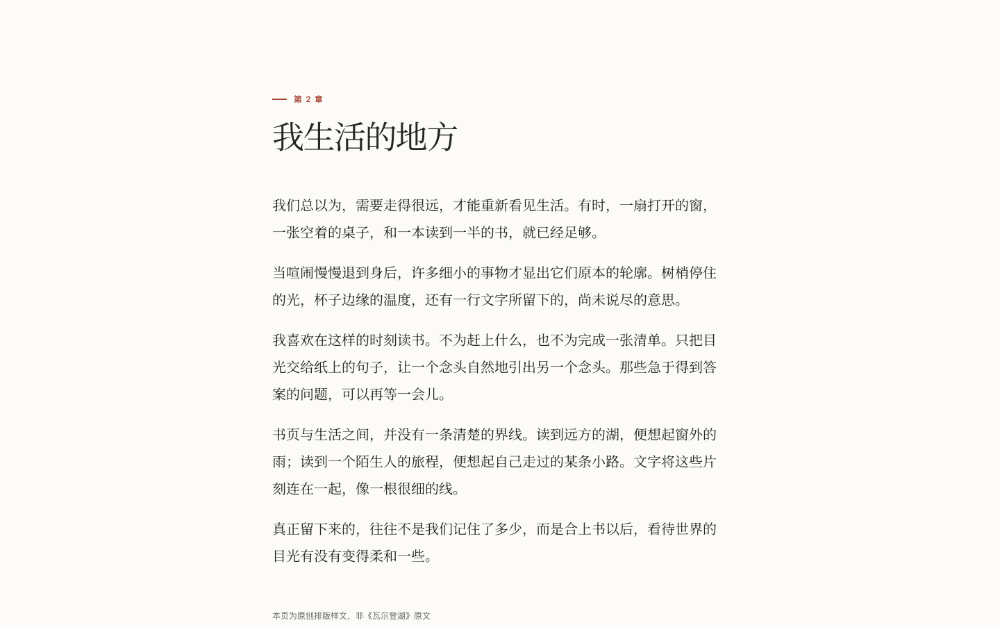

# hearthread

[English](README.md) · 简体中文

hearthread 是一个本地优先的跨平台个人资料库，从沉浸式阅读做起。现在，你可以把 EPUB 电子书、PDF 和 Markdown 文档放进同一面书墙，离线阅读，下次打开时接着上次的位置读。后续会逐步加入图片管理，让书籍、文档和图片都能在同一处整理。





## 主要功能

- 在书墙上按封面找书，也可以切换到列表。打开导入面板，拖入文件并确认，按书名或作者搜索，还可以一次把多本书移入同一分类。
- 双击封面开始阅读，轻点正文唤出工具。可以调整字体、行距和纸色，也可以直接搜索书中的一段话。
- EPUB 支持重排和章节跳转，PDF 可以适应整页或屏幕宽度，Markdown 保留表格和代码块。重新打开文件会回到上次读到的位置。
- 可以单独导出原文件，也可以把整个书库连同阅读位置和偏好备份成 ZIP。换设备时，恢复这份备份即可继续阅读。

## 本地开发

安装 Bun 1.3.10 和 Node.js 22.23 或更新版本。运行原生应用还需要稳定版 Rust 和对应平台的工具链。macOS 需要 Xcode Command Line Tools，Windows 需要 MSVC C++ 构建工具和 WebView2。[Tauri 各平台环境配置](https://v2.tauri.app/start/prerequisites/)

在仓库根目录安装依赖并启动桌面应用。

```sh
bun install --frozen-lockfile
bun run tauri dev
```

在浏览器中开发时，运行 `bun run dev`，打开 `http://127.0.0.1:1420`。浏览器使用独立的 IndexedDB 书库，原生应用将文件和 SQLite 数据库存放在系统应用数据目录。两者之间可以通过 ZIP 备份迁移书库。

| 构建目标 | 命令 |
| --- | --- |
| macOS 应用 | `bun run tauri build --bundles app` |
| Windows 桌面应用 | `bun run tauri build` |
| Apple Silicon 上的 iOS 模拟器 | `bun run tauri ios build --debug --target aarch64-sim` |
| Android arm64 调试版 APK | `bun run tauri android build --debug --apk --target aarch64` |

当前界面使用简体中文。macOS 构建已经过本地验证，仓库也提供了 Windows、iOS 和 Android 的工程配置。[各平台验收记录](docs/verification/README.md)
